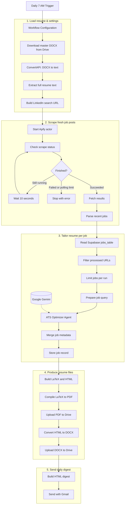
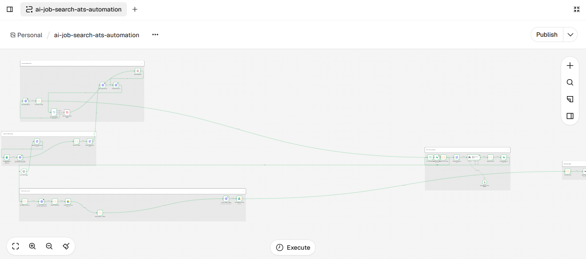

# AI Job Search & ATS Resume Automation

An **n8n workflow** that discovers recent job listings, tailors a master resume to each job description with Google Gemini, produces PDF and Word versions, stores files in Google Drive, tracks processed jobs in Supabase, and emails a daily summary.

> **Status:** Shared as a configurable portfolio/reference workflow. Import and end-to-end execution have **not** been verified in a fresh n8n account. This workflow does **not** submit job applications automatically.

## At a glance

| Item | Current workflow behavior |
| --- | --- |
| Platform | n8n |
| Schedule | Daily at 7:00 AM, workflow timezone `America/Los_Angeles` |
| Search | LinkedIn jobs URL passed to an Apify actor |
| Freshness | LinkedIn URL filters last 24 hours; parser also excludes records older than 7 days |
| Scraper request | `count: 10` (actor-specific input) |
| Daily processing cap | `maxJobsPerRun: 10` (after duplicate filtering) |
| Resume tailoring | Google Gemini through n8n AI Agent |
| Output | PDF (LaTeX) and DOCX (HTML conversion) |
| Storage | Google Drive; Supabase for processed-job records |
| Notification | Gmail HTML digest with job and resume links |

## Architecture — five-stage workflow

The diagram below is **Mermaid**, so GitHub renders it automatically in the README. The image underneath is the actual n8n canvas export.





## How it works: five stages

### 1. Load resume & settings

The **Daily 7 AM Trigger** starts the workflow. **Workflow Configuration** holds the resume file ID, search query, location, recipient email, Apify actor ID, per-run cap, polling cap, and output folder ID. The workflow downloads a **DOCX** master resume from Google Drive, converts it to plain text using ConvertAPI, checks that the text is not empty, and builds a LinkedIn jobs search URL.

### 2. Scrape fresh job posts

Apify starts the configured LinkedIn scraper actor. The workflow polls its run status every **10 seconds**, stopping on success or a failed/timed-out state. It fetches dataset items, strips HTML from descriptions, deduplicates URLs within the result set, and discards listings with insufficient descriptions or older posting dates. Actual job availability and field names depend on the scraper actor.

### 3. Tailor resume per job

Supabase records are loaded to identify previously processed job URLs. The workflow filters duplicates **before** applying the configured processing limit. For each remaining job, an n8n AI Agent prompts Gemini to align existing resume content with the job description, emphasize relevant skills and verifiable achievements, and avoid inventing employers, dates, or metrics. The workflow stores the job URL, title, company, and processing timestamp.

### 4. Produce resume files

A JavaScript code node parses the AI-generated plain-text resume into structured sections, then creates two renderings: **LaTeX compiled into PDF** through a third-party LaTeX compilation endpoint, and **HTML converted to DOCX** through ConvertAPI. Both files are uploaded to the configured Google Drive folder.

### 5. Send daily digest

The final nodes assemble an HTML email containing each processed job's company, role, posting date, original job URL, PDF link, and Word link. Gmail sends it to the configured recipient. The workflow is not designed to send a successful empty digest when no new jobs qualify.

## Accounts and services required

| Service | Why it is needed | Setup |
| --- | --- | --- |
| [n8n](https://n8n.io/) | Workflow automation and scheduling | Cloud or self-hosted instance |
| [Google Drive](https://drive.google.com/) | Master resume download and output storage | Connect Google Drive OAuth2 credential |
| [Google Docs](https://docs.google.com/) | Optional editing/viewing of Word resume files | Google account; no separate Docs node in this workflow |
| [Gmail](https://gmail.com/) | Sends the daily digest | Connect Gmail OAuth2 credential |
| [Google Gemini API](https://ai.google.dev/) | AI resume tailoring | Create API key and Gemini credential in n8n |
| [Apify](https://apify.com/) | Runs a job-listing scraper | Create API token and configure actor access |
| [Supabase](https://supabase.com/) | Stores processed job URLs | Create project and `jobs_table` |
| [ConvertAPI](https://www.convertapi.com/) | DOCX-to-text and HTML-to-DOCX conversions | Create API credentials |
| LaTeX compilation endpoint | Compiles LaTeX to PDF | Current node calls `https://latex.ytotech.com/builds/sync`; check availability and data handling before use |

**Privacy note:** The master resume and tailored resumes contain personal data. Resume content is transmitted to conversion, AI, and PDF-generation services. Review their data-handling policies before using real resumes.

## Supabase table setup

1. Create a Supabase project.
2. Open **SQL Editor** and execute [`supabase/schema.sql`](supabase/schema.sql).
3. Confirm `public.jobs_table` contains `job_url`, `job_title`, `company`, and `processed_at` (plus `id`).
4. Configure the n8n Supabase credential and update **both** `Get Existing Jobs` and `Store Job Record` with your project reference and `jobs_table`.
5. Restrict access using suitable Supabase credentials and row-level security policies. Never publish a service-role key.

The `job_url` column is unique to prevent duplicate entries. The workflow currently reads existing rows and filters in n8n; for large tables, a targeted server-side lookup is more efficient.

## Import into n8n: step by step

1. Download or clone this repository and locate [`workflow/ai-job-search-ats-automation.json`](workflow/ai-job-search-ats-automation.json).
2. Open n8n and create a new workflow.
3. Open the workflow's **three-dot menu** and choose **Import from File** (wording may vary by n8n version).
4. Select the JSON file. Inspect the nodes and connections after import.
5. Open **Workflow Configuration** and replace the placeholder values below.
6. Reconnect each credential in the relevant nodes. Credential references were intentionally removed from the public export.
7. Update both Supabase nodes' project reference, verify `jobs_table`, and verify the Apify actor input schema.
8. Check the Gemini model selection; choose a model available to your API account if the exported model is unavailable.
9. Test the workflow manually with `maxJobsPerRun` set to `1` before increasing the limit.
10. Inspect the resulting PDF/DOCX and email, then enable the schedule in n8n when ready. **Publishing in n8n is not the same as publishing to GitHub.**

### Workflow Configuration fields

| Field | Example / action |
| --- | --- |
| `resumeFileId` | ID of your master `.docx` file in Google Drive |
| `jobSearchQuery` | `Technical Program Manager` |
| `jobLocation` | `San Francisco, CA` |
| `userEmail` | Your digest recipient email |
| `apifyActorId` | `curious_coder~linkedin-jobs-scraper` (verify actor availability) |
| `maxJobsPerRun` | `1` for testing; current default `10` |
| `maxPollAttempts` | Current default `60`; paired with a 10-second wait |
| `outputFolderId` | ID of destination Google Drive folder |

For a Drive URL such as `https://drive.google.com/file/d/FILE_ID/view`, use `FILE_ID` as the resume file ID. For a folder URL such as `https://drive.google.com/drive/folders/FOLDER_ID`, use `FOLDER_ID` as the output folder ID.

### Credential mapping

- **Google Drive OAuth2:** `Download Master Resume`, `Upload PDF to Drive`, `Upload Word to Drive`.
- **ConvertAPI:** `Convert Resume to Text`, `Convert HTML to Word`.
- **Apify HTTP authentication:** `Start Apify Scrape`, `Check Apify Status`, `Fetch Apify Results`.
- **Supabase OAuth2:** `Get Existing Jobs`, `Store Job Record`.
- **Google Gemini credential:** `Google Gemini Chat Model`.
- **Gmail OAuth2:** `Send Digest Email`.

## Expected output

For each newly processed job, the workflow attempts to produce:

```text
Google Drive output folder/
  Technical Program Manager - 2026-11-04.pdf
  Technical Program Manager - 2026-11-04.docx
```

The filenames are based on job title and posting date; multiple jobs with identical titles and dates may have similar names. The daily email includes links to the job listing and uploaded resumes. Access to Drive files is governed by your Google Drive sharing settings; the public export does not guarantee that recipients can open them.

## Cost model and estimated cost per run

**These figures are planning estimates, not measured bills or verified current prices.** A run can incur scraper charges even when no jobs qualify, because scraping happens before deduplication. Charges depend on actor pricing, Gemini tokens, ConvertAPI conversion credits, n8n execution allowances, and service plans.

| Cost component | Usage in this workflow | How to estimate |
| --- | --- | --- |
| Apify | One actor run and up to 10 requested scrape results | Actor run charge + results/compute, per actor's billing model |
| Gemini | One tailoring call per qualifying job (with possible retries) | Input tokens × input rate + output tokens × output rate |
| ConvertAPI | One DOCX→TXT per run; one HTML→DOCX per job | Conversion credits or billed conversions |
| PDF compiler | One PDF per job via external endpoint | Check endpoint terms, quotas, availability |
| Supabase | Read job history, insert records | Free tier or project/database usage |
| Google Drive/Gmail | Upload two files per job and send one digest | Workspace subscription, quotas and storage |
| n8n | One scheduled execution with polling and per-job nodes | Hosted execution allowance or self-hosting costs |

**Illustrative planning scenarios (USD, excluding fixed subscriptions):**

| Jobs tailored | Indicative variable budget per run | Indicative 30-day budget at one run/day |
| ---: | ---: | ---: |
| 1 | $0.05–$0.50 | $1.50–$15 |
| 5 | $0.25–$2.50 | $7.50–$75 |
| 10 | $0.50–$5.00+ | $15–$150+ |

These are *not* vendor quotes, and the lower bound may be exceeded by minimum actor charges. To calculate your actual cost, record a test run's Apify charges, Gemini input/output token counts, ConvertAPI credits consumed, and any n8n overage. Divide shared run-level charges by jobs completed and add per-job conversion and AI costs.

**Example formula:** `run_cost = Apify_run + (Gemini_input_tokens × input_rate) + (Gemini_output_tokens × output_rate) + ConvertAPI_credits + PDF_service + n8n_overage`.


See the latest vendor pricing before budgeting: [Apify](https://apify.com/pricing), [Gemini](https://ai.google.dev/gemini-api/docs/pricing), [ConvertAPI](https://www.convertapi.com/prices), [Supabase](https://supabase.com/pricing), and [n8n](https://n8n.io/pricing/). The scraper `count: 10` controls requested results; `maxJobsPerRun: 10` controls post-deduplication processing.

## Privacy, security and data handling

**Data flow:** your master resume is retrieved from Google Drive, transmitted to ConvertAPI for text extraction, supplied with job descriptions to Gemini, sent as generated LaTeX to a third-party PDF compiler, and rendered as HTML through ConvertAPI for DOCX creation. Resulting files return to Drive. Supabase stores job URLs and metadata; Gmail receives a digest with file links.

| Data / service | Privacy consideration | Recommended safeguard |
| --- | --- | --- |
| Master resume and AI prompts | Names, contact information and career history are processed by external services | Review vendor retention and training policies; use test data first |
| PDF compilation endpoint | Full tailored resume sent to a third-party endpoint | Prefer a trusted or self-hosted compiler for sensitive data |
| Google Drive outputs | Links may not be accessible to intended recipients; broad sharing can expose personal data | Restrict permissions; review sharing before sending |
| Supabase job history | Job URLs, company names and timestamps persist | Apply least-privilege access and suitable RLS policies |
| n8n executions | Execution logs can retain inputs, outputs and resume text | Limit execution-data retention and access |
| Public GitHub export | Credentials, personal IDs, pinned data or embedded secrets can leak | Publish only sanitized exports and review every commit |

**Do not treat a public GitHub repository as a secure location for real resumes or credentials.** The sanitized workflow uses placeholders and requires reconnection after import. Use dedicated test accounts where possible.

## Testing and acceptance checklist

1. Import into a **separate, inactive test workflow** and reconnect credentials.
2. Set `maxJobsPerRun` to `1`; use a synthetic resume for the first test.
3. Run the master-resume extraction and verify the output is legible and complete.
4. Confirm Apify completes, handles failure and timeout paths, and returns expected fields.
5. Verify the duplicate filter excludes a previously stored URL.
6. Review the Gemini output for factual accuracy and the exact `COMPANY | TITLE | DATES` format.
7. Open both PDF and DOCX and check fonts, dates, bullet alignment and document integrity.
8. Verify Drive permissions and that the digest's PDF/DOCX links correspond to the correct job.
9. Repeat with 2–3 jobs to test item matching; check Supabase for duplicate rows.
10. Only then activate the schedule; monitor first live runs and actual vendor costs.

## Limitations and production hardening priorities

- **Not an auto-apply bot:** it prepares resumes and emails links; it does not submit applications.
- **Scraping fragility and compliance:** actor or LinkedIn changes may break extraction; review terms and use authorized data sources where possible.
- **Date assumptions:** scraper date formats may be inconsistent; the parser compares dates as strings.
- **AI output:** Gemini can omit or rearrange details; human review is required before submitting any resume.
- **Premature deduplication:** the workflow writes the Supabase record *before* PDF/DOCX generation; failed jobs may be skipped next time. Consider recording status and marking complete only after both uploads succeed.
- **Digest pairing:** it currently pairs items by array index, which may mismatch job and file links when item counts/order diverge. Prefer stable job IDs.
- **Empty runs:** when no new jobs qualify, the workflow does not reliably send an explicit zero-jobs digest.
- **Scale:** `Get Existing Jobs` loads all rows; use indexed URL lookups or database-side filtering for larger datasets.
- **PDF service:** an external LaTeX compiler introduces availability and confidentiality dependencies.
- **No guaranteed ATS score, interview outcome, or vendor uptime.**

## Troubleshooting and known limitations

| Symptom | What to check |
| --- | --- |
| Master resume text empty | `resumeFileId`, Drive permissions, DOCX format, ConvertAPI response |
| Scraper returns no jobs | Actor availability, URL/input schema, blocked requests, freshness filters |
| Gemini node fails | Credential, model availability, quotas, prompt/output format |
| Supabase fails | Project reference, table name, schema, permissions, RLS |
| PDF compilation fails | LaTeX endpoint, font availability (`texgyreheros`), LuaLaTeX syntax |
| DOCX conversion fails | ConvertAPI credentials, HTML input and binary field |
| No digest arrives | No qualifying jobs, upstream failure, Gmail credential |
| Links cannot be opened | Google Drive file-sharing permissions |

- The AI prompt requires `COMPANY | TITLE | DATES` lines; the layout parser expects that structure. Unexpected model formatting may break rendering.
- The workflow **stores a job record before file generation completes**. A later conversion failure can cause the job to be skipped on subsequent runs.
- The digest assembles job/PDF/Word results by array index. Multi-item executions should be tested carefully to ensure links match the right job.
- The parser relies on the scraper's date and description fields. Missing or non-ISO dates may affect filtering.
- The public workflow includes a third-party LaTeX endpoint; review its reliability, security, and privacy before use.
- This workflow is **not** an auto-apply bot, does not guarantee ATS scores, and does not guarantee interviews.

## Responsible use and LinkedIn disclaimer

**Scraping LinkedIn may violate LinkedIn's terms of service**, and LinkedIn may block automated requests or change its pages without notice. Users are responsible for reviewing LinkedIn's terms, applicable laws, data privacy obligations, and the Apify actor's permitted use. Prefer official APIs, licensed feeds, or employer career pages where available. This repository is for educational and portfolio purposes and is not affiliated with LinkedIn, Apify, Google, or n8n.

## Security before sharing

This repository includes a **sanitized workflow export**. Credential objects, personal recipient email, private Google Drive IDs, and the Supabase project reference were replaced or removed. **Do not upload raw n8n exports**, execution logs, resume documents, access tokens, `.env` files, or API keys to a public repository. Review changes with `git diff` before every commit.

## GitHub publishing

See [`docs/GITHUB_PUBLISHING.md`](docs/GITHUB_PUBLISHING.md) for beginner-friendly browser and command-line steps.

## License

No license has been selected. Until one is added, the default copyright restrictions apply. Choose an open-source license before inviting reuse.

## Engineering Decisions & Trade-offs

This project demonstrates the orchestration of AI, external APIs, document generation, and persistent state through an automated job-search pipeline. The following design decisions explain the architecture, operational considerations, and opportunities for improvement.

### 1. Asynchronous Job Scraping — Apify

**Decision:** Use Apify to execute LinkedIn job discovery asynchronously, with a polling loop that checks the execution status every 10 seconds.

**Rationale:** Job scraping may take longer than a synchronous API request. Separating execution from result retrieval helps accommodate variable processing times.

**Reliability controls:**
- Retry failed HTTP requests.
- Stop polling when the scraping job succeeds or fails.
- Configure a maximum number of polling attempts.
- Surface failures through an explicit error node.

**Trade-off:** Polling is straightforward to implement but introduces repeated API calls and additional execution time. A webhook-based callback could reduce polling overhead.

### 2. Duplicate Detection — Supabase

**Decision:** Store processed job URLs and metadata in Supabase and compare newly discovered jobs against existing records.

**Rationale:** Prevent repeated resume generation for previously processed job opportunities, reducing unnecessary AI and document conversion costs.

**Trade-off:** URL-based deduplication is simple but may miss duplicate postings that use different tracking parameters or URLs.

**Future improvement:** Normalize job URLs, enforce database uniqueness, and implement upsert operations to handle concurrent executions safely.

### 3. AI-Assisted Resume Optimization — Google Gemini

**Decision:** Use a Gemini-powered AI agent to tailor an existing master resume to each job description.

**Rationale:** Reuse verified professional experience while improving alignment with job-specific responsibilities and ATS terminology.

**Controls:**
- Provide the master resume as source context.
- Require a structured output format.
- Instruct the AI not to invent employers, employment dates, qualifications, or performance metrics.

**Trade-off:** Prompt instructions alone cannot guarantee factual accuracy or consistent formatting.

**Future improvement:** Add schema validation, automated factual consistency checks, and human approval before application submission.

### 4. Multi-Format Resume Generation — PDF and Word

**Decision:** Generate two resume formats from a common parsed representation: LaTeX for PDF and HTML converted to DOCX.

**Rationale:** PDF supports consistent visual presentation, while DOCX provides an editable version for recruiters and applicants.

**Trade-off:** Maintaining two rendering paths introduces additional dependencies and potential formatting differences.

**Future improvement:** Add automated document validation, PDF rendering checks, and tests for special characters, employment dates, and long bullet points.

### 5. Cost and Resource Controls

**Decision:** Limit the number of jobs processed per execution and filter previously processed opportunities before invoking AI and document-generation services.

**Rationale:** AI inference, scraping, and file conversion can incur variable costs. Limiting processing volume provides a predictable operational boundary.

**Current controls:**
- Configurable maximum jobs per run.
- Duplicate filtering before resume tailoring.
- Scheduled daily execution.
- Bounded polling attempts.

**Trade-off:** Limiting daily throughput may defer relevant job opportunities to subsequent executions.

**Future improvement:** Introduce cost-per-job telemetry, usage dashboards, budget thresholds, and prioritization based on job relevance.

### 6. Privacy and Responsible AI

**Decision:** Keep credentials in n8n credential storage and publish a sanitized workflow export rather than the private production configuration.

**Considerations:**
- Resume contents are transmitted to external AI and conversion services.
- Generated documents may contain personally identifiable information.
- Google Drive access permissions must be configured appropriately.
- Public GitHub files must not contain tokens, private document identifiers, or personal resume content.
- AI-generated resumes require factual review before use.

### 7. Current Limitations

This project is a portfolio/reference implementation rather than a fully validated production service.

Known limitations include third-party scraper reliability, potential changes to LinkedIn access policies, AI-generated formatting inconsistencies, multi-item data alignment risks, and the possibility of recording a job as processed before document generation completes.

Future iterations will focus on improved error recovery, stronger output validation, end-to-end observability, and transactional processing.
